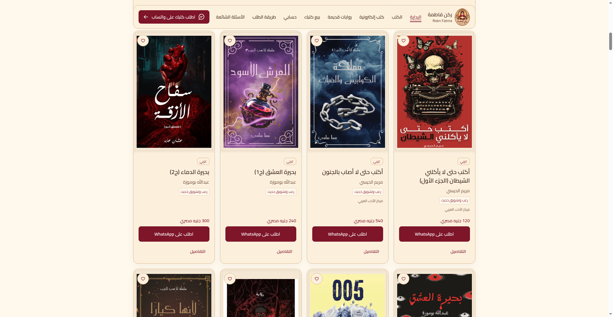
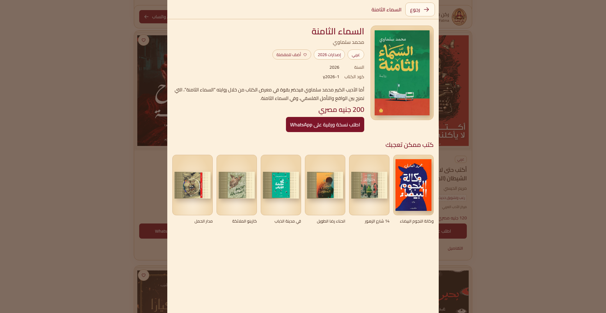

# ركن فاطمة | Rokn Fatma

An Arabic online bookstore - full catalog, free public-domain reader, and WhatsApp ordering. Built with vanilla HTML/CSS/JS, hosted on GitHub Pages.

**Live:** https://mostafa3srawy-cyber.github.io/rokn-fatma/

## Features

- 1,100+ books with live search, genre filters, and favorites (Arabic + English)
- Book details dialog with description, edition, price, and direct WhatsApp order
- Free built-in reader for 53 public-domain books
- Clear shipping rates, delivery times, and payment methods (InstaPay / mobile wallet)
- RTL-first responsive design, works offline-friendly with versioned caching

## Stack

Plain HTML, CSS, and JavaScript. No build step, no framework. Data in `catalog.json`, covers self-hosted in `covers/`, deployed on GitHub Pages.
